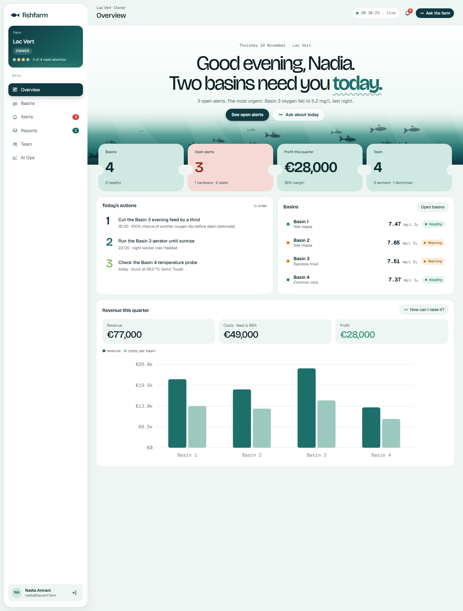
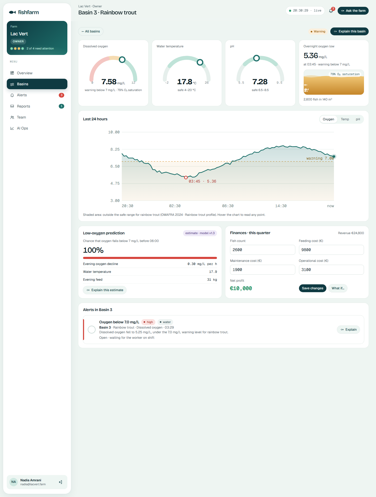
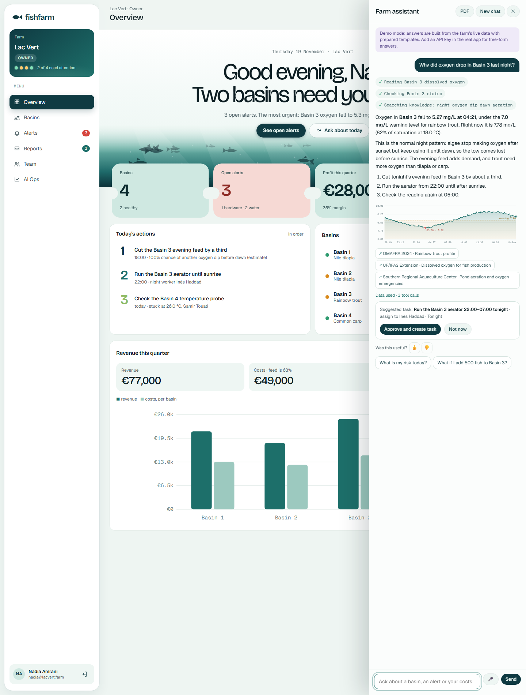
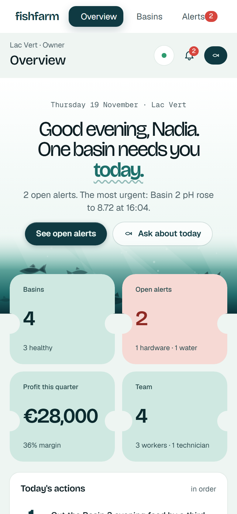
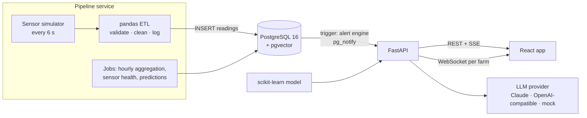

# FishFarm

**Smart water · smarter farming.** A fish-farm monitoring web app: live water quality for every basin,
alerts that reach the right person, team management, basin finances, an oxygen-drop prediction model and
an AI farm assistant that answers with the farm's own data.

It is a full product, not a mock-up. Readings flow from a sensor simulator through a pandas data pipeline
into PostgreSQL, where a SQL trigger raises the alerts. A FastAPI back end serves a React front end and
pushes every change live over WebSockets.



| Basin detail | Farm assistant | Phone |
|---|---|---|
|  |  |  |

## Run it

```bash
docker compose up --build
```

Open **http://localhost:8080**. The first start migrates the database, loads the demo farm (30 days of
readings), trains the model and indexes the knowledge base. This takes about a minute.

| Role | Email | Password | Sign in on |
|---|---|---|---|
| Owner | `nadia@lacvert.farm` | `demo1234` | Owner sign in |
| Worker | `karim@lacvert.farm` | `demo1234` | Team sign in |
| Technician | `samir@lacvert.farm` | `demo1234` | Team sign in |

No API key is needed: the assistant then runs in **demo mode**. It calls the same tools on the same live data and
answers from templates. For free-form answers, copy `.env.example` to `.env`, set `ANTHROPIC_API_KEY=...`, and
run `docker compose up` again.

## What it does

- **Owner:** a live overview (open alerts, today's three actions, profit), basins with live gauges and 24-hour
  charts, editable finances, alerts, a reports inbox with read state, team accounts and permissions, and AI Ops.
- **Worker:** today's shift, water alerts to tick off with a note, tasks and shift reports.
- **Technician:** probe health (stuck, drifting, spiky, offline), hardware alerts and maintenance logs.
- **New owners** get an empty farm. They add their first basin (its three probes are created automatically), or
  load the demo farm with one click.
- Every number, alert, report, task and permission comes from the back end and survives a refresh. Changes reach
  every open screen of the farm instantly.

## Architecture



**Data flow of one reading:**

1. The simulator produces a reading for each probe every 6 seconds: a day-night random walk per species.
   It also produces some dirty data and occasional probe faults on purpose.
2. The ETL (pandas) rejects missing, impossible and duplicate values, logs the counts in `etl_runs`,
   and inserts the clean rows.
3. A **PostgreSQL trigger** on `readings` compares the value with the species safe range. It opens one alert per
   probe with a severity, recalculates the basin status, and publishes an event with `pg_notify`.
4. The API listens for those events and forwards them over WebSocket to the clients of the same farm. The React
   app updates values, tanks, gauges, badges and counters without reloading the page.
5. Batch jobs aggregate hourly statistics, detect broken probes from rolling statistics (and route them to the
   technician), and refresh the oxygen predictions every 5 minutes.

## Tech stack

| Layer | Technology |
|---|---|
| Front end | React 18, TypeScript, Vite, React Router, the approved prototype's own CSS and hand-drawn SVG charts, GSAP 3.12.5, Lenis |
| Back end | Python 3.12, FastAPI, Pydantic v2, SQLAlchemy 2.0, Alembic |
| Database | PostgreSQL 16, pgvector, SQL trigger for alerts, row-level security for the assistant role |
| Auth | bcrypt, JWT access token, rotating refresh token in an httpOnly cookie, roles, permissions checked on the server |
| Realtime | PostgreSQL `LISTEN/NOTIFY` → FastAPI WebSocket |
| Data engineering | Simulator service, pandas ETL with accept/reject logging, hourly aggregation, sensor-health job, 30-day backfill with `COPY` |
| Machine learning | scikit-learn random forest, time-based evaluation |
| AI assistant | Claude Haiku via the Anthropic API (default), any OpenAI-compatible endpoint such as Ollama, or a deterministic mock; SSE streaming; hybrid RAG |
| Quality | pytest (44 tests), Ruff, ESLint, Prettier, Playwright (13 end-to-end flows), GitHub Actions |
| Packaging | Docker, docker compose (db, api, pipeline, frontend) |

## Machine learning: oxygen drop before dawn

The model predicts whether dissolved oxygen will fall below the species warning level before 06:00, so the farmer can act in the evening.
It is trained on 30 days of history with features such as the evening oxygen decline, last night's low,
temperature, pH, hour of day and feeding load. The test set is the last 25 % of the period, never shuffled.

| Held-out week | Precision | Recall | F1 |
|---|---|---|---|
| Random forest | 0.89 | 1.00 | 0.94 |
| Baseline "it dipped last night" | 0.98 | 1.00 | 0.99 |

The simple baseline wins on this simulated data, and [`ml/README.md`](ml/README.md) explains why. The predictions are
always labelled as estimates.

## AI farm assistant

A narrow farm copilot, not a general chatbot. Deterministic code owns alerts, thresholds and tenant boundaries.
The language model only chooses which trusted tool to call and explains the result.

```mermaid
sequenceDiagram
  participant U as User (React panel)
  participant A as FastAPI agent loop
  participant L as LLM provider
  participant T as Typed tools
  participant D as PostgreSQL (ai_reader + RLS)
  U->>A: POST /api/chat/stream (JWT)
  A->>L: system prompt + farm index + question + tool schemas
  L-->>A: tool call, e.g. get_readings(Basin 3, oxygen)
  A->>T: validate arguments (Pydantic)
  T->>D: SET ROLE ai_reader; app.owner_id from the JWT
  D-->>T: rows of this farm only
  T-->>A: compact JSON in <tool_data>
  A-->>U: SSE: tool step, chart, sources
  A->>L: tool result
  L-->>A: streamed answer (+ proposed task)
  A-->>U: SSE: tokens, approval card, follow-ups, done
```

- **14 tools** (12 read, 2 write): basins, readings, alerts, maintenance, finances, oxygen prediction, knowledge search,
  sensor health, basin comparison, what-if simulator, daily briefing, plus task creation and alert acknowledgement.
  The two write tools only run after the user clicks **Approve**.
- **Knowledge base:** 11 paraphrased, cited notes (FAO, UF/IFAS, SRAC, OMAFRA, Stehfest et al.). Hybrid search combines
  PostgreSQL full text with vector similarity using Reciprocal Rank Fusion. Answers show their sources.
- **Panel:** streamed text, tool-step chips, inline charts, risk cards, comparison bars, "Data used", approval cards,
  thumbs up/down, follow-ups, conversation history, a stop button, voice input, PDF export, French / English / Arabic (RTL),
  and an emergency banner when a basin is critical.
- **AI Ops page** (owner): requests per day, latency, cost, most-used tools and feedback.

### Evaluation (44 golden cases, run in CI with the mock provider)

| Metric | Score |
|---|---|
| Tool correctness | 1.00 |
| Retrieval hit@4 / MRR | 1.00 / 0.92 |
| Out-of-scope refusals | 1.00 |
| Action requests ask for approval | 1.00 |
| Forbidden content (prompt injection, other farm's data, money for workers) | 1.00 |
| Answer language (French, Arabic) | 1.00 |
| **Number grounding** (every number in the answer appears in that turn's tool results) | **0.95** |
| Probe-fault detection (stuck / drift / spiky), precision and recall | 1.00 |

The ungrounded 5 % are advice times written into the demo templates (for example "check again at 05:00").
Model-judged faithfulness and relevancy need a real model and an API key, so they are not part of CI.
Details are in [`evals/results.json`](evals/results.json).

## Security design

- **Multi-tenancy:** every query is filtered by the farm of the signed-in user, taken from the database, never from the request.
  A basin of another farm answers "not found".
- **Permissions are enforced by the API** (403), not just hidden in the menu, and pushed live to the member's screen.
- **Assistant isolation:** the tools run as a read-only `ai_reader` role on `security_invoker` views, and PostgreSQL row-level security
  limits every row to `app.owner_id`. The server sets that id from the JWT; the model never supplies it. Password hashes are not readable.
- **Prompt injection:** text written by people (reports, notes) reaches the model inside `<tool_data>` as data. Answers are rendered
  as escaped markdown, never raw HTML. An eval case checks a malicious maintenance note.
- **Limits:** 10 assistant requests per minute and 100 per day per user, a daily token budget, 2,000 characters of input, 5 tool rounds.
- **Secrets:** API keys only in the back end's `.env`, which is git-ignored. Passwords are hashed with bcrypt. The refresh token is
  httpOnly, rotated on use, and revoked on sign-out.

## Limitations

- The farm is simulated. The model's scores and the stats on the website describe simulated data, not a real farm.
- The demo assistant answers from templates. Free-form answers in any wording need an API key (or a local model through Ollama).
- The default knowledge-base embeddings are a lightweight hashing embedder, so the image stays small and works offline. A multilingual
  sentence-transformers model is supported (`EMBEDDING_BACKEND=sentence_transformers`) but not installed by default.
- Sea bass and sea bream have no verified thresholds yet. Only generic oxygen limits are used, and they are flagged as not verified.
- No email or SMS notifications: alerts reach people in the app.

## Develop without Docker

```bash
# back end (Python 3.11+, PostgreSQL running)
cd backend && pip install -r requirements-dev.txt
alembic upgrade head && python -m app.seed && python -m app.assistant.ingest
uvicorn app.main:app --reload            # API on :8000
python -m app.pipeline.runner            # simulator + ETL + jobs
pytest                                   # 44 tests

# front end
cd frontend && npm install && npm run dev   # http://localhost:5173
npx playwright test                         # end-to-end flows
```

More detail: [How it works](docs/HOW_IT_WORKS.md) · [Decisions](docs/DECISIONS.md) · [Visual check](docs/VISUAL_CHECK.md) ·
[ML](ml/README.md)
